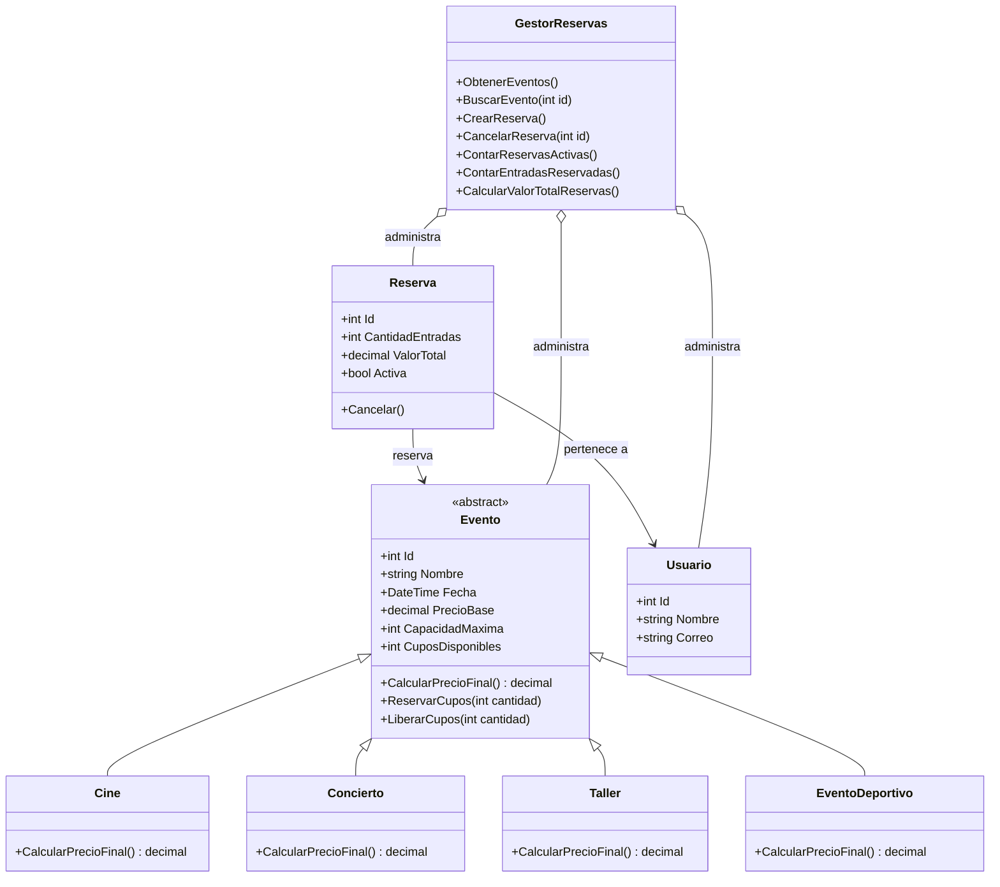

# PLANAZO - Sistema de Gestion de Eventos

**Estudiante:** Dilan Tapia Mercado

**Lenguaje:** C#

**Plataforma:** .NET

**Tipo de aplicacion:** Consola

## 1. Descripcion del proyecto

PLANAZO es una aplicacion de consola desarrollada en C# que permite gestionar eventos y realizar reservas de entradas. El sistema permite consultar eventos, verificar la disponibilidad de cupos, registrar reservas, cancelar reservas y consultar un resumen de las operaciones realizadas.

El proyecto utiliza programacion orientada a objetos para organizar el codigo mediante clases, herencia, abstraccion, encapsulamiento y polimorfismo.

## 2. Objetivo

Desarrollar una aplicacion que facilite la administracion de eventos y reservas, garantizando el control de los cupos disponibles, el calculo correcto de los precios y la validacion de las operaciones realizadas por los usuarios.

## 3. Funcionalidades principales

- Listar los eventos disponibles.
- Consultar la informacion de un evento.
- Realizar reservas de entradas.
- Validar la cantidad de entradas solicitadas.
- Controlar los cupos disponibles de cada evento.
- Calcular el precio de las entradas segun el tipo de evento.
- Consultar todas las reservas registradas.
- Consultar las reservas de un usuario.
- Cancelar reservas y liberar los cupos correspondientes.
- Evitar la cancelacion duplicada de una reserva.
- Mostrar un resumen de reservas activas, entradas reservadas y valor total.
- Manejar errores y operaciones no permitidas.

## 4. Tipos de eventos

El sistema incluye los siguientes tipos de eventos:

| Tipo de evento | Regla de precio |
|---|---|
| Cine | Conserva el precio base. |
| Concierto | Aumenta el precio base en un 15 %. |
| Taller | Aplica un descuento del 10 %. |
| Evento deportivo | Aumenta el precio base en un 20 %. |

La aplicacion inicia con siete eventos de ejemplo para facilitar las pruebas.

## 5. Estructura del proyecto

```text
PLANAZO-POO-CSharp-DilanTapiaMercado/
│
├── Modelos/
│   ├── Evento.cs
│   ├── Cine.cs
│   ├── Concierto.cs
│   ├── Taller.cs
│   ├── EventoDeportivo.cs
│   ├── Usuario.cs
│   └── Reserva.cs
│
├── Servicios/
│   └── GestorReservas.cs
│
├── Capturas/
│
├── Program.cs
├── PLANAZO-POO-CSharp-DilanTapiaMercado.csproj
└── README.md
```

## 6. Descripcion de las clases

### Evento

Es una clase abstracta que contiene las propiedades comunes de los eventos, como el identificador, nombre, fecha, precio base, capacidad maxima y cupos disponibles. Tambien define el metodo `CalcularPrecioFinal()` y controla la reserva y liberacion de cupos.

### Cine

Hereda de `Evento` y calcula el precio final conservando el precio base.

### Concierto

Hereda de `Evento` y calcula el precio final aplicando un incremento del 15 %.

### Taller

Hereda de `Evento` y calcula el precio final aplicando un descuento del 10 %.

### EventoDeportivo

Hereda de `Evento` y representa un tipo adicional de evento. Aplica un incremento del 20 % sobre el precio base.

### Usuario

Almacena la informacion de los usuarios que realizan reservas, incluyendo identificador, nombre y correo electronico.

### Reserva

Representa una reserva de entradas. Relaciona un usuario con un evento, almacena la cantidad de entradas, registra el valor total y controla el estado de la reserva.

### GestorReservas

Administra los eventos, usuarios y reservas. Permite buscar eventos, registrar reservas, cancelar operaciones y calcular los resultados del resumen general.

### Program.cs

Contiene el menu principal y permite al usuario interactuar con las funcionalidades del sistema desde la consola.

## 7. Aplicacion de la programacion orientada a objetos

### Abstraccion

Se utiliza la clase abstracta `Evento` para representar las caracteristicas y operaciones comunes de los eventos sin crear directamente objetos de esa clase.

### Herencia

Las clases `Cine`, `Concierto`, `Taller` y `EventoDeportivo` heredan de `Evento`, reutilizando sus propiedades y metodos.

### Polimorfismo

Cada tipo de evento implementa el metodo `CalcularPrecioFinal()` con una regla diferente para determinar el precio de sus entradas.

### Encapsulamiento

Las propiedades de las clases utilizan modificadores de acceso, como `private set`, para proteger los datos y controlar las modificaciones mediante metodos.

## 8. ¿Por que se utiliza una clase abstracta?

La clase `Evento` es abstracta porque define las caracteristicas y comportamientos comunes de los eventos, pero no representa por si misma un tipo especifico de evento. De esta manera, las clases derivadas pueden heredar sus propiedades y definir su propia implementacion del metodo `CalcularPrecioFinal()`.

## 9. Validaciones implementadas

- El identificador de los eventos, usuarios y reservas debe ser valido.
- El nombre del usuario es obligatorio.
- El correo electronico debe cumplir las validaciones establecidas.
- La cantidad de entradas debe ser mayor que cero.
- No se permite reservar mas entradas de las disponibles.
- Al cancelar una reserva activa, los cupos vuelven a estar disponibles.
- No se permite cancelar dos veces la misma reserva.
- Se muestran mensajes de error cuando una operacion no puede realizarse.

## 10. Tecnologias utilizadas

- C#
- .NET
- Visual Studio Code
- Git
- GitHub

## 11. Instrucciones de ejecucion

### Requisitos

Tener instalado el SDK de .NET.

### Compilar el proyecto

Desde la terminal, dentro de la carpeta principal del proyecto, ejecutar:

```bash
dotnet build
```

### Ejecutar la aplicacion

Desde la misma carpeta, ejecutar:

```bash
dotnet run
```

## 12. Casos de prueba

En la carpeta `Capturas` se incluyeron imagenes del funcionamiento de la aplicacion, como:

1. Registrar una reserva válida.
2. Intentar reservar más entradas que los cupos disponibles.
3. Intentar realizar una reserva con una cantidad negativa.
4. Cancelar una reserva y comprobar que se devuelven los cupos.
5. Intentar cancelar dos veces la misma reserva.
6. Consultar un evento inexistente.
7. Comprobar que cada tipo de evento calcula correctamente su precio final.


## 13. Diagrama UML

El siguiente diagrama representa la estructura del sistema PLANAZO, la herencia entre los tipos de eventos y las relaciones entre las reservas, los usuarios y el gestor.



## 14. Conclusion

El desarrollo de PLANAZO permitio aplicar conceptos de programacion orientada a objetos en C#, organizar el codigo en clases independientes y construir un sistema de gestion de eventos y reservas. Ademas, se implementaron validaciones para controlar los cupos, calcular precios y gestionar correctamente las cancelaciones.
